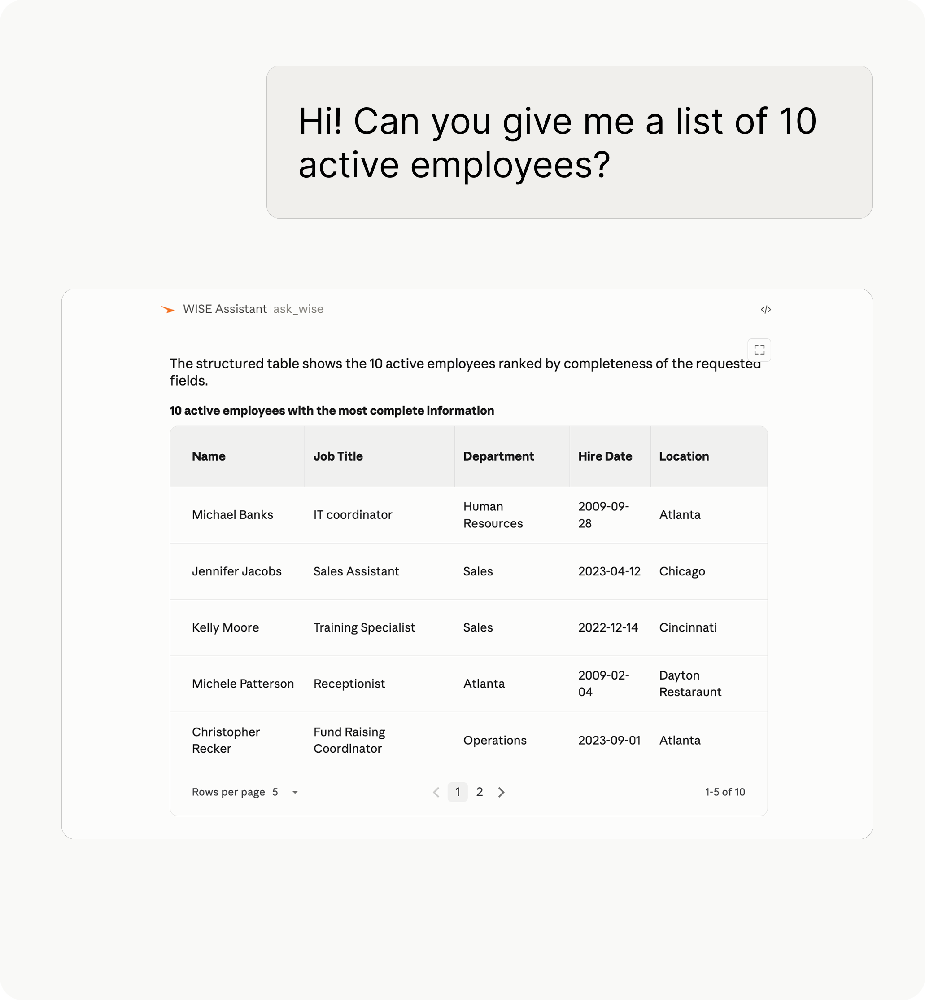
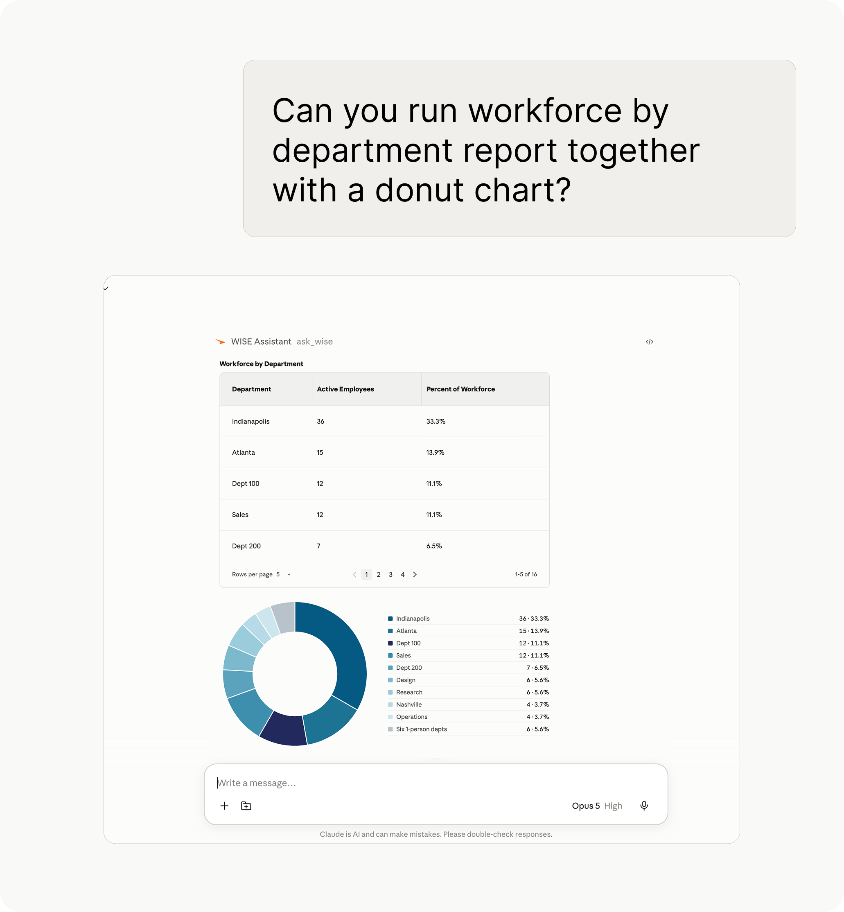
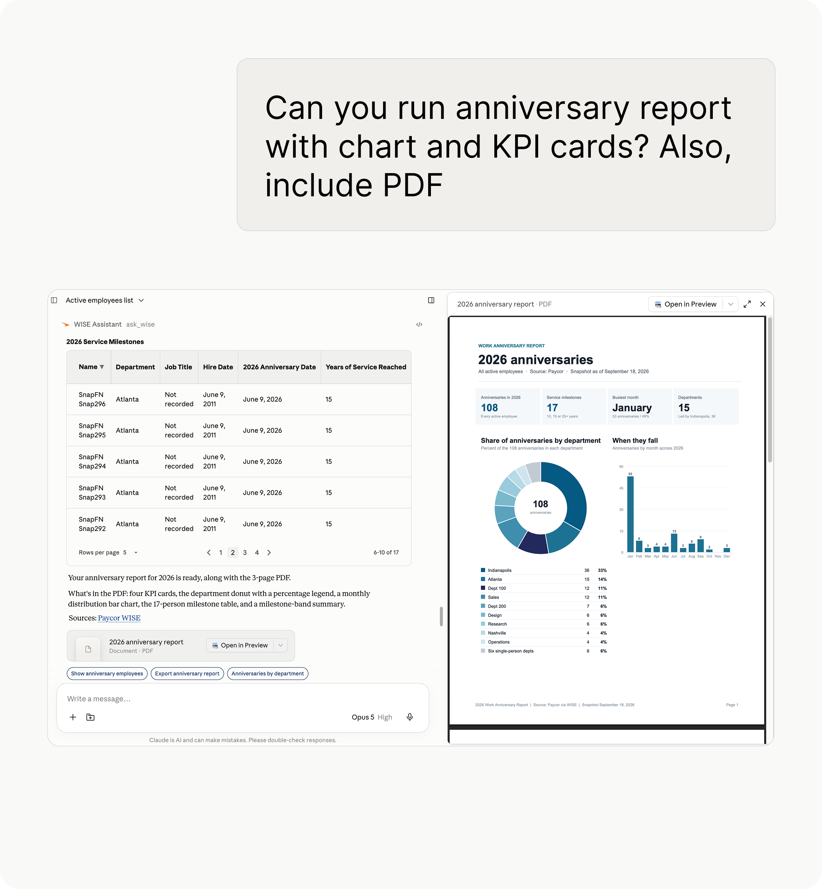
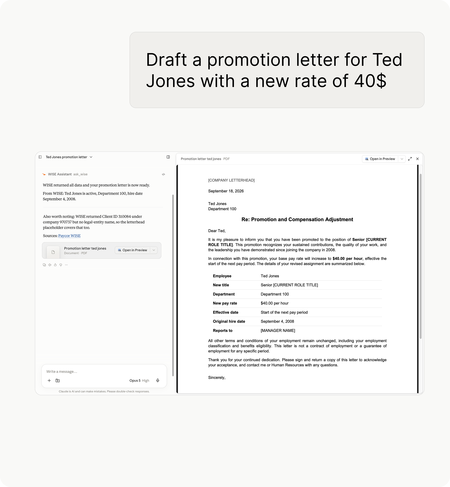
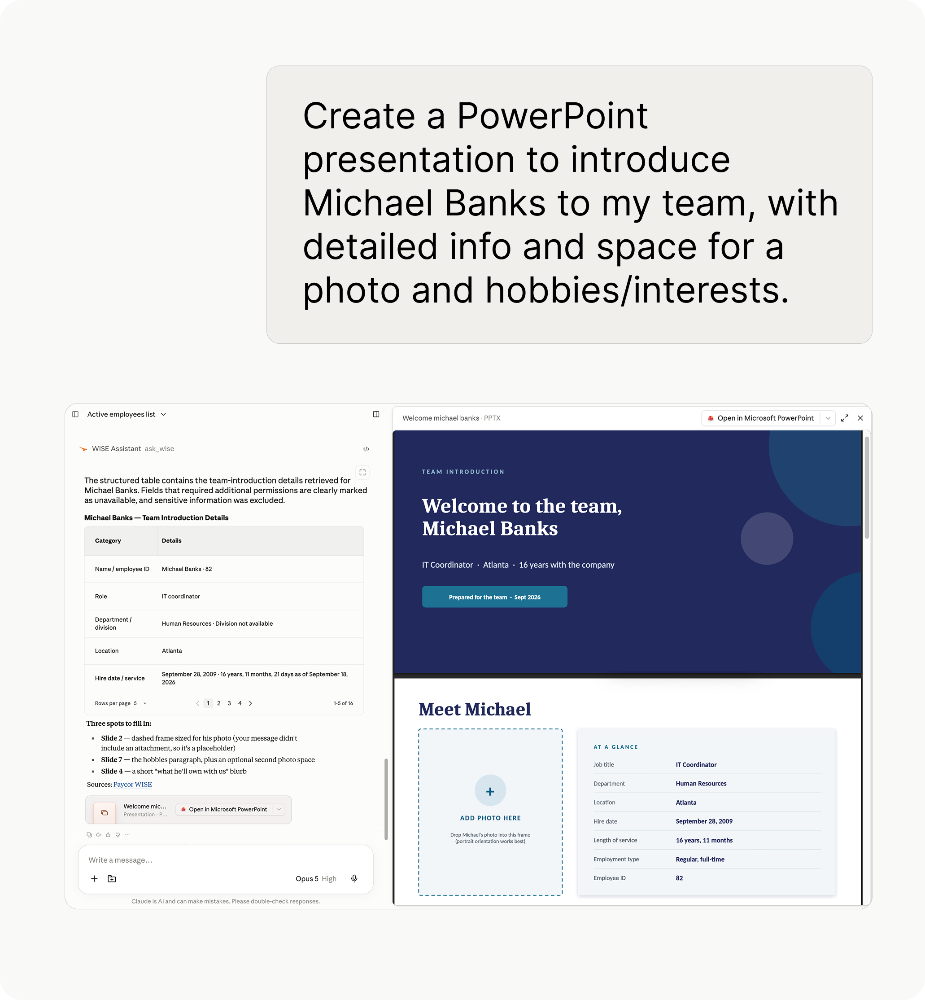

# Use cases

Example prompts and the results Claude produces with the Paycor WISE Assistant plugin. All screenshots use Paycor demo data.

| Prompt | Screenshot |
|---|---|
| Hi! Can you give me a list of 10 active employees? | [list-active-employees.png](list-active-employees.png) |
| Can you run workforce by department report together with a donut chart? | [run-report-with-chart.png](run-report-with-chart.png) |
| Can you run anniversary report with chart and KPI cards? Also, include PDF | [run-report-with-kpi-pdf.png](run-report-with-kpi-pdf.png) |
| Draft a promotion letter for Ted Jones with a new rate of 40$ | [promotion-letter.png](promotion-letter.png) |
| Create a PowerPoint presentation to introduce Michael Banks to my team, with detailed info and space for a photo and hobbies/interests. | [create-powerpoint.png](create-powerpoint.png) |

## List active employees

## Run a report with a chart

## Run a report with KPI cards and a PDF

## Draft a promotion letter

## Create a PowerPoint presentation

